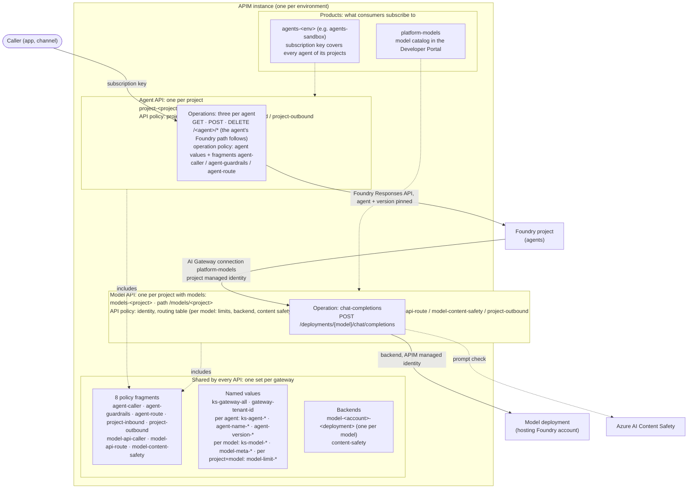
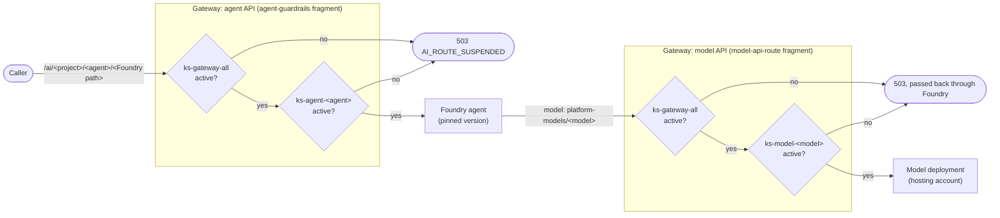

# AI gateway (platform repository)

The AI platform's gateway: one Azure API Management instance per environment, the Microsoft Foundry accounts that host
models and agents, and the shared gateway policy every use case runs through (kill switches, content safety, limits,
routing). Use cases (their Foundry projects, model access and agents) are onboarded and deployed from the project
repository, **[agent-deployment](https://github.com/DeepuMM/agent-deployment)**.

## Pipelines

Two pipelines, one per kind of deployment, each its own workflow and run: **`gateway-policy-deployment`** (the shared policy
fragments) and **`model-platform-deployment`** (model hosting). Both go through stages **dev → uat → prd**.
All sign in to Azure with GitHub OIDC (no secrets).

```
.github/workflows/
  gateway-policy-deployment.yml   plan ─► dev ─► uat ─► prd   (unit _policies.yml)
  model-platform-deployment.yml   plan ─► dev ─► uat ─► prd   (unit _models.yml)
  ci.yml         repository checks (no Azure)
.github/actions/setup, tf-init   shared steps (Python, Terraform, Azure sign-in, state backend)
```

Each run reads `plan` ─► `dev / deploy …` ─► `uat / …` ─► `prd / …`. The order is set by `needs`: uat waits for dev,
prd for uat. uat and prd run only on release tags, after approval, and only when `PLATFORM_ENVIRONMENTS` lists them
(otherwise they show as skipped). The two pipelines don't depend on each other.

### Triggers

| Event | gateway-policy-deployment | model-platform-deployment |
|---|---|---|
| pull request | plan in dev, when `gateway/policy-fragments/` or its stack changed | plan in dev, when `gateway/foundry-accounts/` or its stack changed |
| merge to `main` | stage **dev**, same paths | stage **dev**, same paths |
| release tag `v*` | both: **dev**, then **uat** and **prd**, each after approval | |
| manual run | dev | dev |
| any pull request or merge (`ci.yml`) | Terraform format, validate and plan tests of both stacks; scripts parse | |

One push to `main` starts **at most one run of each pipeline**. Each pipeline deploys one thing per environment (the
shared policy, or the environment's models), so a stage is a single box, not a matrix.

| The merge changes | gateway-policy-deployment | model-platform-deployment |
|---|---|---|
| `gateway/policy-fragments/agent-route.xml` | 1 run: dev | — |
| `gateway/foundry-accounts/<account>/models/<model>/model.yaml` | — | 1 run: dev (every model of the environment's accounts is planned; only the changed one changes) |
| both of the above | 1 run: dev | 1 run: dev (independent of the policy run) |
| `README.md`, `gateway/scripts/**` | — (only `ci`) | — (only `ci`) |
| release tag `v1.2.0` | 1 run: dev, uat, prd | 1 run: dev, uat, prd |

### What each pipeline deploys

| Pipeline | What it does | Terraform state |
|---|---|---|
| `gateway-policy-deployment`: the shared gateway policy | the **policy fragments** in `gateway/policy-fragments/` (kill switches, limits, routing, identity checks, content safety) that every project's agent, model and tool API includes; the **global kill switch** `ks-gateway-all` (created `active` once); the named value `gateway-tenant-id`; the **Content Safety backend** `content-safety` (managed identity); the gateway's Application Insights logger. A change reaches every project of the environment at once, with no project redeployed. Smoke test: every fragment is on the gateway, the global kill switch state, the model registry | `ai-gateway-policies-<env>.tfstate` |
| `model-platform-deployment`: host the models | for each model of the environment's hosting accounts (`gateway/foundry-accounts/<account>/` with `environment: <env>`): the deployment (version, SKU, capacity) with its **guardrail**, an APIM **backend**, a **registry entry** `model-meta-<model>`, a **kill switch** `ks-model-<model>` (created `active` once), the model in the `platform-models` **catalog**. Smoke test (deployment healthy, backend registered, kill switch set), then the Developer Portal. **It creates no API anyone can call:** each project gets its own model API, `models/<project>`, from use-case onboarding in the project repository | `ai-gateway-models-<env>.tfstate` |

**When a run stops, nothing has changed yet** if it stops in a plan: a fragment file doesn't start with `<fragment>`,
or the environment has no Content Safety account. During an apply, Azure can refuse a change (an invalid policy, no
quota or permission); what was applied before it in that run stays; fix and run again.

### Stages and promotion

| Stage | Runs on | Approval | GitHub environment |
|---|---|---|---|
| **dev** | merges to `main`, manual runs, release tags | none | `model-dev` |
| **uat** | release tags `v*`, after dev succeeded for that commit | required reviewers | `model-uat` |
| **prd** | release tags `v*`, after uat succeeded | required reviewers | `model-prd` |

- A stage runs only if the **repository variable `PLATFORM_ENVIRONMENTS`** lists it, comma-separated in promotion
  order. Today it is `dev`: uat and prd have GitHub environments (with approval) but no resources of their own yet,
  and a stage that pointed at dev's gateway with its own Terraform state would try to create what dev already owns.
  Add them (`dev,uat,prd`) once they have their own resources.
- A tag promotes **exactly the tagged commit**. Approval is GitHub's environment protection: each job of uat and prd
  waits until a reviewer approves it in the run (Actions > the run > Review deployments).
- The shared policy has no evaluation gate and reaches every project of an environment at once; the stages are what
  let a fragment change prove itself in dev before uat and prd.
- A model-hosting account belongs to one environment (`account.yaml` `environment`). Offering a model in uat or prd
  means adding it under that environment's account: a deliberate choice per environment, not a copy of dev.
- The project repositories release on their own tags; in each environment a project's plan stops with "run the
  gateway policy first" if a fragment it needs isn't deployed there yet.

### Platform stack (`gateway/sandbox`, applied by a platform engineer)

Creates the platform an environment runs on: APIM, the Foundry accounts for models and for agents, the Azure AI
Content Safety account, Terraform state storage, the pipeline identity with its roles and its GitHub trust (for both
repositories), and APIM's own roles. Local state; see [gateway/sandbox/README.md](gateway/sandbox/README.md). Its
output is the set of values for `scripts/set_github_environment.sh` (below).

### Environment settings: GitHub variables

Nothing about an environment is kept in this repository. Each GitHub environment `model-<env>` holds its coordinates
as **variables** (not secrets); the jobs pass them to Terraform (`TF_VAR_*`) and to the scripts
(`gateway/scripts/platform_env.py`). They are written by `scripts/set_github_environment.sh <env> KEY=VALUE ...`:

| Variable | Meaning | dev (uat and prd: the same, for now) |
|---|---|---|
| `AZURE_CLIENT_ID`, `AZURE_TENANT_ID`, `AZURE_SUBSCRIPTION_ID` | pipeline sign-in; the tenant is also `gateway-tenant-id` | `id-promptops-pipeline`, `scbx-testing` |
| `APIM_SUBSCRIPTION_ID`, `APIM_RESOURCE_GROUP`, `APIM_NAME` | the gateway (URL `https://<APIM_NAME>.azure-api.net`) | `apim-agents-3471ad` |
| `MODELS_PRODUCT` | the model catalog product | `platform-models` |
| `CONTENT_SAFETY_ACCOUNT`, `CONTENT_SAFETY_RESOURCE_GROUP` | Azure AI Content Safety for the prompt checks (required) | `cs-tst-3471ad` |
| `APP_INSIGHTS_NAME`, `APP_INSIGHTS_RESOURCE_GROUP` | gateway telemetry and token metrics (optional) | `aiazrgtstmodelnpr013471ad` |
| `PORTAL_ANONYMOUS` | products visible in the portal without sign-in | `false` |
| `TF_STATE_RESOURCE_GROUP`, `TF_STATE_STORAGE_ACCOUNT`, `TF_STATE_CONTAINER` | Terraform state | `stscbxtf3471ad5a` / `tfstate` |
| `RECORDS_STORAGE_ACCOUNT`, `RECORDS_CONTAINER` | decision records, immutable (required for a deployment; container default `records`) | the state account / `records` |

Repository variable `PLATFORM_ENVIRONMENTS`: the stages the platform deploys to (`dev`). Hosting accounts are the
folders under `gateway/foundry-accounts/` (`account.yaml`). The project repository keeps its own GitHub environments
(`model-<env>`, `agent-<env>`) with the same coordinates.

### Permissions

| Who | Role | Scope | For |
|---|---|---|---|
| Pipeline identity | **Foundry Account Owner** | each hosting Foundry account | model deployments and guardrails |
| | **API Management Service Contributor** | the APIM instance | backends, named values, fragments, products, portal |
| | **Reader** | the Content Safety account | lookup for the backend |
| | **Storage Blob Data Contributor** | the Terraform state container | state |
| | Federated credential | the identity, trusting `repo:<owner>@<id>/ai-gateway@<id>:environment:model-<env>` | GitHub OIDC sign-in |
| APIM managed identity (runtime) | **Foundry User** | each hosting account and the agent account | call the models and the agents |
| | **Cognitive Services User** | the Content Safety account | prompt checks |
| Platform engineer (platform stack) | Owner, or Contributor + Role Based Access Control Administrator | the platform resource group | create resources and role assignments |

Step-by-step flows, triggers and validation of both jobs: [gateway/README.md](gateway/README.md).

The project repository's pipelines use the same pipeline identity with further roles on the agent account (see its
README). In the sandbox, `id-sbx-pipeline` has Contributor on the resource group, which covers the Contributor-level
rows.

## Model onboarding and approval

A model is requested with the **Model onboarding request** issue form and approved by **reviewing its pull request**.

1. **Request** (issue form): model, version, use case, risk tier, AICOE tier record, AIIA, people impact, owner,
   sponsor. `model-intake` checks it (complete, version pinned, tier 0 refused) and says what to fix.
2. **Pull request**: once the request passes, `model-intake` writes the model folder and opens the pull request. Its
   description is a plain-language summary, so an approver doesn't need to read YAML. Editing the request updates the
   pull request.
3. **Approval of record** (the pull request review): GitHub asks the code owners (`.github/CODEOWNERS`) to review.
   - **Model risk** owns `governance.yaml`.
   - **AI platform** owns `model.yaml`, `docs.md` and `tests.yaml`.
   - They **Approve**, **Request changes** (the requester edits the request) or **close** the pull request to reject it (the requester closing it withdraws the request).
   - `model-intake-decision` reports each decision on the request and, on merge, posts the approval record: who
     approved which commit, and who merged it.
4. **Merge** deploys and registers the model in dev. No project uses it until it's evaluated and approved for that
   project.

**Separation of duties.** The pull request is opened by the workflow bot, so GitHub's own "authors can't approve" rule
doesn't stop the requester. The required check `separation-of-duties` (`scripts/approval_check.py`) passes only when
every changed file is approved by one of its code owners who isn't the requester, the pull request author or a
committer. The approval must be on the current commit, and the check reads its rules from the base branch.

Branch protection on `main` (Settings > Branches) makes this binding:
- Require a pull request, with 1 approval.
- Require review from Code Owners.
- Dismiss stale approvals when new commits are pushed.
- Required status check `separation-of-duties` (a commit status the check posts; the latest result wins).
- Do not allow bypassing.

**Test bed.** One account stands in for both teams, so one approval covers both roles: it shows the mechanism, not
two real teams. In the bank, CODEOWNERS names teams (`@<org>/model-risk`, `@<org>/ai-platform`), and the check needs a
token that can read team membership.

## Lifecycle state and decision records

**Lifecycle state.** Each model's `governance.yaml` holds `lifecycle.state`: `onboarded` → `evaluated` → `validated`
→ `retired`. A new model starts as `onboarded`. The state changes only by a merged, reviewed pull request; a pipeline
can propose the next state, with its evidence, but never sets it. Terraform copies the state into the registry entry
(`model-meta-<model>`, field `lifecycle`), so APIM shows it. Terraform is the only writer of the registry; nobody
edits it in the portal. Suspension at runtime is the kill switch, not a lifecycle state.

**Decision records.** After `terraform apply` and the smoke test succeed on `main` (or on a release tag),
`scripts/record.py` writes **one record per changed model** to an **immutable** storage container. Each record is JSON
and holds:
- the event: `onboarded`, `lifecycle <old> -> <new>`, `changed`, `removed`, or `deployed` (tag or manual run);
- the model, its version, lifecycle state and governance record;
- the merged pull request: title, author, approved commit, approvers on that commit, who merged it and when, and a
  hash of its description;
- the run that applied it;
- a SHA-256 of every file of the model folder.

A record is written only after the change is in effect, so a failed apply leaves no record. A deployment can't run
without the record store (the job stops before apply when `RECORDS_STORAGE_ACCOUNT` isn't set). The upload is keyless:
the pipeline's OIDC identity, Storage Blob Data Contributor on the container.

Blob names: `<env>/models/<model>/<UTC time>-<commit>.json`. The container has a **time-based immutability policy**
(WORM): a blob can't be changed or deleted until its retention ends. In the test bed the policy stays **unlocked** (an
account admin can still shorten or remove it). In the bank it must be **locked**, with the retention the records
policy requires; locking can't be undone.

The merged pull requests are the Git-side history. Records aren't kept in Git: the pipeline can't push to a protected
`main`, and repository admins can rewrite Git history.

## Two repositories

| | **ai-gateway**, this repository (platform team) | **agent-deployment** (use-case teams) |
|---|---|---|
| Platform | APIM, Foundry accounts for models and for agents, Content Safety (`gateway/sandbox`); the environment's coordinates as GitHub variables | a copy of the environment files |
| Model hosting | `model-platform-deployment`: model deployments, registry, catalog | — |
| Shared gateway policy | `gateway-policy-deployment`: policy fragments, global kill switch, Content Safety backend | — |
| Use-case onboarding | — | `use-case-onboarding`: Foundry project, model API, token budget, content safety settings, connected models |
| Agent deployment | — | `agent-deploy`: agent versions, evaluation gate, agent API, docs, smoke test |

The project repository never reads this repository's files: it reads what the gateway serves (the model registry
`model-meta-*`, the policy fragments) from APIM and stops with a clear message when something is missing.

## AI gateway (APIM) structure

Everything callers and agents reach goes through one API Management instance per environment (sandbox:
`apim-sbx-bbf0o`). Inside it, **each project gets one agent API with one operation per agent**, and **each project
that lists models gets one model API**. The logic they share lives once per gateway (policy fragments, named values,
backends).



### What is in the test gateway today

```text
apim-agents-3471ad
├── Products
│   ├── agents-test ────────────────── APIs: project-models-demo, project-proj-default   (subscription key + Entra token)
│   └── platform-models ────────────── APIs: models-models-demo, models-proj-default     (catalog; project identities only)
├── APIs
│   ├── project-models-demo           /ai/models-demo                 agent API of project models-demo
│   │   ├── basic-code-agent-{get,post,delete}   /basic-code-agent/*    hosted (code) agent
│   │   └── demo-assistant-{get,post,delete}     /demo-assistant/*      prompt agent
│   ├── project-proj-default          /ai/proj-default                agent API of project proj-default
│   │   ├── expense-policy-agent-{get,post,delete}
│   │   └── leave-policy-agent-{get,post,delete}
│   ├── models-models-demo            /models/models-demo             model API of project models-demo
│   │   └── chat-completions               POST /deployments/{model}/chat/completions
│   └── models-proj-default           /models/proj-default            model API of project proj-default
│       └── chat-completions               POST /deployments/{model}/chat/completions
├── Policy fragments                  agent-caller, agent-guardrails, agent-route, project-inbound, project-outbound,
│                                     model-api-caller, model-api-route, model-content-safety
├── Named values
│   ├── gateway:  ks-gateway-all, gateway-tenant-id
│   ├── agents:   ks-agent-<agent>, agent-name-<agent>, agent-version-<agent>   (× 4 agents)
│   └── models:   ks-model-gpt-5-4-mini, model-meta-gpt-5-4-mini, model-limit-<project>-gpt-5-4-mini
└── Backends                          model-aif-tst-models-3471ad-gpt-5-4-mini  →  aif-tst-models-3471ad/openai
                                      content-safety                            →  cs-tst-3471ad
```

### One per what, created by whom

| APIM object | One per | Name | Created by |
|---|---|---|---|
| Agent API | project | `project-<project>`, path `ai/<project>` | `agent-deploy` (`register`) |
| Agent operations | agent | `<agent>-get`, `<agent>-post`, `<agent>-delete` on `/<agent>/*` | `agent-deploy` (`register`) |
| Agent API policy / operation policy | project / agent | from the project repository's `templates/` | `agent-deploy` (`register`), project repository |
| `ks-agent-*`, `agent-name-*`, `agent-version-*` | agent | | `agent-deploy` (`register`) |
| Product `agents-<env>` | as set in `project.yaml` `gateway.product` | e.g. `agents-sandbox` | `agent-deploy` (`register`) |
| Foundry project (in the agent Foundry account, not in APIM) | project | `foundry.project` | use-case onboarding, project repository |
| Model API + its policy | project | `models-<project>`, path `models/<project>` | use-case onboarding, project repository |
| `model-limit-<project>-<model>` | project and model | | use-case onboarding, project repository |
| AI Gateway connection (in the Foundry project, not in APIM) | project | `models.connection`, unique per agent account | use-case onboarding, project repository |
| Model backend, `ks-model-*`, `model-meta-*` | model | `model-<account>-<deployment>` | `model-platform-deployment` |
| Product `platform-models` | gateway | | `model-platform-deployment` |
| Policy fragments, `ks-gateway-all`, `gateway-tenant-id`, backend `content-safety` | gateway | | `gateway-policy-deployment` |

The model deployment itself exists **once** per model in its hosting account; every project's model API routes to
the same deployment through the same backend. What differs per project is the front door: who may call it, which
models, how many tokens, which content safety settings.

### Policy layering: what runs on a call

APIM runs the operation policy, which calls the API policy at `<base />`. Thin per-project and per-agent policies
hold only their own values and include the shared fragments.

```text
Agent call   <method> /ai/<project>/<agent>/<the agent's Foundry path>   (subscription key + caller's Entra token)
             e.g. POST .../basic-code-agent/endpoint/protocols/openai/responses?api-version=v1   (hosted)
                  POST .../demo-assistant/openai/v1/responses                                 (prompt)
└─ operation policy  <agent>-<method>                       project repository: templates/agent-operation-policy.xml
   ├─ set variables: agent, kind, ks-agent-<agent>, agent-name, agent-version, rate limit
   ├─ fragment agent-caller         caller's Entra token (aud https://ai.azure.com) validated, object ID kept
   ├─ fragment agent-guardrails     global kill switch → agent kill switch → agent rate limit
   ├─ quota-by-key                  agent daily quota
   ├─ <base /> ─► API policy  project-<project>             project repository: templates/project-policy.xml
   │              ├─ set variable: project rate limit
   │              ├─ quota-by-key   project daily quota
   │              └─ fragment project-inbound   project rate limit, correlation ID, APIM managed identity
   ├─ fragment agent-route          the agent's own Foundry endpoints only (else 404), body/query/headers unchanged;
   │                                prompt: agent_reference = evaluated version; hosted: x-ms-user-identity = caller,
   │                                new sessions bound to the evaluated version (endpoint pinned in Foundry)
   └─ outbound: <base /> ─► fragment project-outbound (correlation ID)
   ──► Foundry project runs the agent ──► the agent calls its model:

Model call   POST /models/<project>/deployments/<model>/chat/completions   (project's managed identity token)
└─ API policy  models-<project>                             project repository: onboarding/terraform/policies/…tftpl
   ├─ set variables: project, project resource ID
   ├─ fragment model-api-caller      Entra token check: only this project's identity (else 401)
   ├─ routing table (per allowed model): ks-model-<model>, token limits, backend, deployment,
   │                                     content safety settings (cs-*: model level, else project level), if any
   ├─ fragment model-api-route       global kill switch → 404 if model not allowed → model kill switch
   │                                 → token limit → backend → APIM managed identity
   ├─ fragment model-content-safety  Azure AI Content Safety on the prompt (403 if flagged)
   └─ outbound: fragment project-outbound (correlation ID)
   ──► model deployment in the hosting account
```

See [Shared policy](#shared-policy-policy-fragments), [Kill switches](#kill-switches) and
[Content safety](#content-safety) for each part in detail.

## Layout

| Path | What it is |
|---|---|
| `gateway/sandbox/` | the disposable sandbox platform (Terraform, local state), see [gateway/sandbox/README.md](gateway/sandbox/README.md) |
| `gateway/foundry-accounts/<account>/` | hosting accounts and their models (`model.yaml`, `docs.md`, `tests.yaml`: AI platform; `governance.yaml`: model risk) |
| `gateway/terraform/platform-deployment/` | model platform deployment stack |
| `gateway/policy-fragments/<id>.xml` | the shared policy logic, one APIM policy fragment per file |
| `gateway/terraform/gateway-policies/` | gateway policy stack: fragments, global kill switch, tenant, Content Safety backend |
| `gateway/scripts/` | model smoke test, Developer Portal publishing |
| `.github/workflows/` | `gateway-policy-deployment.yml`, `model-platform-deployment.yml`, `ci.yml`, and the units `_policies`, `_models` |
| `.github/actions/` | shared steps: `setup` (Python, Terraform, Azure sign-in), `tf-init` (state backend) |
| `scripts/intake.py`, `scripts/approval_check.py`, `scripts/record.py` | model intake (request check, model folder, pull request summary); the separation-of-duties check; decision records |
| `.github/CODEOWNERS` | who must approve which files |
| `scripts/release_plan.py` | which stages run and whether each pipeline has a change (their `plan` job) |
| `scripts/set_github_environment.sh`, `gateway/scripts/platform_env.py` | setting an environment's GitHub variables; reading them |

## Shared policy (policy fragments)

The gateway logic every agent shares (kill switch check, rate limit, forwarding to Foundry with managed identity,
routing to the agent's Foundry endpoint at its evaluated version) is in APIM **policy fragments**, one per file in `gateway/policy-fragments/`.
Each agent operation and project API policy only sets its own values as context variables and includes the fragments:

```xml
<set-variable name="agent" value="expense-policy-agent" />
<set-variable name="agent-kind" value="prompt" />
<set-variable name="agent-status" value="{{ks-agent-expense-policy-agent}}" />
<set-variable name="agent-rate" value="@(30)" />  ...
<include-fragment fragment-id="agent-caller" />
<include-fragment fragment-id="agent-guardrails" />
<quota-by-key calls="2000" renewal-period="86400" counter-key="..." />
<base />
<include-fragment fragment-id="agent-route" />
```

| Change | Pipeline | Agents redeployed |
|---|---|---|
| `gateway/policy-fragments/*.xml` (shared logic) | `gateway-policy-deployment`: plan on the PR, dev on merge, uat and prd on a release tag (approval), for **every** environment; then smoke-tests every project model API and agent on that gateway | none: every agent and model API uses the new fragment at once |
| the project repository's policy templates (which values are passed, which fragments are included) | that repository's `agent-deploy` / use-case onboarding | that repository's projects |
| an agent's limits or version | `agent-deploy`, that project | that project |

| Fragment | Included by | Does |
|---|---|---|
| `agent-guardrails` | agent operation policy, before `<base />` | global kill switch `ks-gateway-all` and agent kill switch (503), agent rate limit |
| `agent-caller` | agent operation policy, before `<base />` | validates the caller's Entra token (the one it would send to Foundry: audience `https://ai.azure.com`, this tenant); keeps its object ID; removes caller-sent `x-ms-user-identity` / `x-ms-user-isolation-key` |
| `agent-route` | agent operation policy, after `<base />` | **transparent route**: the caller's Foundry path after `/<project path>/<agent>/` goes to the agent's Foundry endpoint with body, query string and headers unchanged. Hosted: `endpoint/...` only, `x-ms-user-identity` = caller (per-caller sessions), new sessions bound to the evaluated version. Prompt: `openai/v1/responses` and `openai/v1/conversations` only, `agent_reference` = evaluated version. Anything else: `404 AGENT_PATH_NOT_ALLOWED` |
| `project-inbound` | project API policy | project rate limit, correlation ID (caller's `x-correlation-id`, else its `traceparent` trace ID, else the request ID), managed identity |
| `project-outbound` | project API policy, project model API policy | correlation ID on the response |
| `model-api-caller` | project model API policy (project repository's use-case onboarding) | only the project's Foundry identity (token claim `xms_mirid`; tenant from named value `gateway-tenant-id`) |
| `model-api-route` | project model API policy, after its routing table | global kill switch `ks-gateway-all` (503), 404 `MODEL_NOT_ALLOWED`, model kill switch, token limit, backend, managed identity |
| `model-content-safety` | project model API policy, after `model-api-route` | Azure AI Content Safety on the prompt (403 if flagged), settings per model (model, else project, else platform defaults), see [Content safety](#content-safety) |
| `tool-caller` | tool API policy (project repository's use-case onboarding), first | only the identities of the projects the tool is shared with (owner and `shared_with`, token claim `xms_mirid`, `401 CALLER_NOT_ALLOWED`); removes the caller's token so it never reaches the tool |
| `tool-route` | tool API policy, after `tool-caller` | global kill switch and the tool's `ks-tool-<project>-<tool>` (503), calls per minute per calling project, answers MCP `tools/call` for any tool the owner didn't expose itself, with a tool error `TOOL_NOT_ALLOWED` (MCP result `isError: true`); the server is never called; responses stream through unbuffered |

The project model API policy keeps only its routing table (allowed models with their kill switch, token limits,
backend and deployment).

The daily quotas (`quota-by-key`) stay in the agent operation and project policies, with literal values: APIM accepts
no policy expression in `quota-by-key calls`. The rate limits and token limits take their values from context
variables (`llm-token-limit token-quota` must be a `long`, hence `@(…L)`).

### How the fragments are deployed

Only `gateway-policy-deployment` writes fragments (Terraform stack `gateway/terraform/gateway-policies`, state
`ai-gateway-policies-<env>.tfstate`), together with the named values they read directly: `gateway-tenant-id` and the
global kill switch `ks-gateway-all` (see [Kill switches](#kill-switches)), and the backends they call (the Content
Safety backend `content-safety`, see [Content safety](#content-safety)). It runs stage by stage
([Stages and promotion](#stages-and-promotion)):

1. Pull request: format, validate, plan tests (`ci`), and a plan in dev.
2. Merge to `main`: dev: plan → apply → gateway smoke test (every fragment is on the gateway, the global kill switch,
   the model registry).
3. Release tag: dev, then uat and prd, each after approval.

The project repository only references fragments by name: its agent release and onboarding plan check that the
fragments they include are on the gateway, and stop with "run the gateway policy first" if not. A fragment change is
verified end to end by each project's next onboarding or agent run (or a manual run).

### Change the shared policy

1. Edit `gateway/policy-fragments/<id>.xml` (the file name is the fragment ID; the root element is `<fragment>`).
   A fragment reads its inputs from context variables; the comment at the top of each file lists them.
2. Open a pull request and review the plan.
3. Merge: dev gets it at once. Every agent and model API of dev uses the new logic; check the projects there.
4. Release tag: uat, then prd, each after approval.

A fragment change has no evaluation gate and reaches every project at once: review it like platform code. A new
fragment must be deployed (merged and applied) before a template that includes it is merged.

## Content safety

Every prompt sent to a platform model is checked by **Azure AI Content Safety at the gateway**, before it reaches
the model. This covers agent calls of every project and the evaluation gate's judge, because all of them reach models
through the project's model API (`models/<project>`). It is a second layer: the model deployment's own guardrail
(`guardrail` in `model.yaml`) still applies too, also to the model's answers.

| What is checked | Platform default | Blocked when |
|---|---|---|
| Harm categories **Hate**, **Sexual**, **SelfHarm**, **Violence** | threshold **4** each, on a severity scale from 0 (safe) to 7 | the prompt's severity in a category is at or above its threshold |
| **Prompt Shields** | on | the prompt is a jailbreak or prompt-injection attempt ("ignore your instructions…") |

A blocked prompt never reaches the model and uses no tokens. The model API returns **`403`** ("Request failed content
safety check"); an agent's caller gets the failure through Foundry. The check runs after the kill switches and the
allowed-model check, so suspended or refused calls cost no Content Safety call.

### Per project and per model

Content safety is resolved **per model** of each project, in this order:

1. the **model's** own setting: `models.allowed[].content_safety`
2. else the **project's** setting: `models.content_safety` (applies to every model of the project)
3. else the **platform default**: severity `4` per category, Prompt Shields on

So two models in one project can have different settings, for example a stricter one for a model that is less
safe on its own. Settings can only be **stricter** than the platform, at both levels: a category from `0` to `4`
(lower blocks more), and `prompt_shields` can only be `true`. The project repository's `ci` and onboarding plan
reject anything else; the settings live in its `project.yaml`.

```yaml
models:
  connection: platform-models
  content_safety:              # project level, optional: every model of the project
    self_harm: 3
  allowed:
    - name: gpt-5.4-mini       # no model level -> self_harm 3 (project), hate/sexual/violence 4 (platform)
      tokens_per_minute: 20000
      tokens_per_day: 500000
    - name: other-model
      tokens_per_minute: 5000
      tokens_per_day: 50000
      content_safety:          # model level, optional: this model only, on top of the project level
        violence: 2            # -> violence 2 (model), self_harm 3 (project), hate/sexual 4 (platform)
```

| Model | hate | sexual | self_harm | violence | prompt_shields |
|---|---|---|---|---|---|
| `gpt-5.4-mini` | 4 (platform) | 4 (platform) | **3** (project) | 4 (platform) | on (platform) |
| `other-model` | 4 (platform) | 4 (platform) | **3** (project) | **2** (model) | on (platform) |

The settings reach every agent that uses the project's AI Gateway connection with that model. In the reference
projects, `proj-default` sets `violence: 2` and `models-demo` runs on the platform defaults; the project repository's
onboarding smoke test proves the difference on every run.

### Answer checks (opt-in, off by default)

`model-content-safety` can also check the model's **answers** (`enforce-on-completions`). It is **off by default**:
a project turns it on in its `project.yaml` with `content_safety.check_answers: true`, for every model
(`models.content_safety`) or for one (`models.allowed[].content_safety`); onboarding passes it to the gateway as
`cs-check-answers`. Answers are then checked with the same categories and the same thresholds as the project's
prompts. A flagged answer is replaced by `403`. Foundry streams its model calls; a streamed answer is checked in
1,000-character windows and forwarding **stops** at the first flagged window (APIM returns no `403` then: the agent
gets a cut-off answer, and Foundry reports "an error occurred while streaming the response").

Why opt-in: each checked answer costs one Content Safety call per 1,000 characters and adds latency, and when Content
Safety is unavailable the answer is stopped too (see [Availability](#availability-content-safety-fails-closed)).
Without it, answers are still filtered by the model deployment's guardrail (`model.yaml` `guardrail`). Turn it on
for use cases whose answers need the same thresholds as their prompts (for example customer-facing content).

Example: "Summarise the plot of Macbeth, including how each major character dies." has a prompt at Violence 1 and an
answer at Violence 3. With answer checks on, it is answered at the default threshold 4 and stopped at `violence: 2`;
a question with a harmless answer passes at both.

### Which text is checked: the latest user message

The prompt check scores **what the user sent**: the latest `user` message of the request. The rest of a request to
the model is written by the platform and the agent, not by the user: Foundry starts every agent call with a
developer message ("You are an AI assistant accessed via an API...", plus the agent's instructions), followed by the
conversation history and tool results. `llm-content-safety` scores all the text it is given as one; scored together
with that framing, a harmful user message would be rated much lower than on its own (a Violence-5 prompt scores 0).
So `model-content-safety` gives the policy a copy of the request that holds only the latest user message, and
restores the full request before it goes to the model. Earlier user messages were checked when they were sent.

### Token metrics

Both hops emit token metrics (`llm-emit-token-metric`, namespace `ai-gateway`; prompt, completion and total tokens)
to the environment's Application Insights (`gateway.app_insights`; the gateway diagnostic has custom metrics on and
W3C correlation, and logs no headers or bodies):

| Hop | Fragment | Dimensions |
|---|---|---|
| model call | `model-api-route` | `Project`, `Model`, `Hop`=`model` |
| agent call (Responses) | `agent-route` | `Project`, `Agent`, `Subscription ID` (consumer), `Hop`=`agent` |

Metric names: `Prompt Tokens`, `Completion Tokens`, `Total Tokens`, plus the cached, reasoning and audio token
counts the model reports. They are emitted for both agent kinds (prompt and hosted). Use them for showback per
project and consumer, capacity planning against each model's TPM, and alerts on unusual consumption.

```kusto
customMetrics
| where customDimensions["Hop"] == "model"
| summarize tokens = sum(value) by name, proj = tostring(customDimensions["Project"]), model = tostring(customDimensions["Model"]), bin(timestamp, 1h)
```

Model calls also return `x-ratelimit-remaining-tokens`, `x-ratelimit-remaining-quota-tokens` and `x-tokens-consumed`.

### Compared with APIM's built-in AI gateway (portal import of a Foundry API)

The portal's "Microsoft Foundry" import creates one API per Foundry resource with a managed-identity backend and,
optionally, `llm-token-limit`, `llm-emit-token-metric`, semantic caching and `llm-content-safety`. This gateway uses
the same policies, per project and per model, and adds what the import doesn't have:

| | Portal import | This gateway |
|---|---|---|
| Model deployment in Foundry | must exist | created from `model.yaml` (or adopted) |
| API | one, every model, any key holder | one per project, only its allowed models (`MODEL_NOT_ALLOWED`), only its Foundry identity |
| Token limit / quota (`llm-token-limit`) | one per API | per project and model, shares checked against the model's capacity |
| Token metrics (`llm-emit-token-metric`) | per API | per project/model and per project/agent/consumer |
| Content safety (`llm-content-safety`) | one setting per API | platform default + stricter per project/model; checks the latest user message (see above) |
| Kill switches, registry, catalog, agent APIs | – | global/model/agent switches, `model-meta-*`, catalog page, transparent agent APIs |
| How | portal wizard, by hand | Git and pipelines, per environment |

Answer checks (`enforce-on-completions`) are available per project, off by default (see Answer checks).

Further APIM capabilities this reference leaves out, to add where an environment needs them:

| Capability | When to add it |
|---|---|
| Content Safety blocklists (`<blocklists>`) | organisation-specific terms to block on top of the harm categories |
| Backend pools with a circuit breaker | more than one deployment or region per model, or two Content Safety accounts (see Availability) |
| Prompt and completion logging to Azure Monitor | audit trails that need the text of prompts and answers (mind data protection and retention) |
| Semantic caching (`llm-semantic-cache-*`) | repeated questions at volume; needs Azure Managed Redis and an embeddings model |

### Availability: Content Safety fails closed

When Azure AI Content Safety can't be reached or returns an error, `llm-content-safety` rejects the request with the
same `403 "Request failed content safety check"` as a real block. This is deliberate: no prompt reaches a model
unchecked. It also means a Content Safety service problem shows up as blocked requests.

Operating it:

- **Tell the two apart** in the gateway logs (`ApiManagementGatewayLogs`): both have
  `LastErrorReason = ContentSafetyPolicyViolated`; a service problem has `InternalError` in `LastErrorMessage`.
- **Before tightening a project's thresholds**, run its smoke tests and evaluation datasets through the gateway and
  check the cause of every `403` in the logs.
- **For higher availability**, put a second Content Safety account (another region) behind an APIM backend pool with
  a circuit breaker and point the `content-safety` backend at the pool.

### How it is built

| Piece | Where | Deployed by |
|---|---|---|
| The check, with the platform defaults | fragment `model-content-safety` (`llm-content-safety`), included by every project model API after `model-api-route` | `gateway-policy-deployment` |
| A project's and its models' settings | in its model API policy, each model's routing-table branch sets `cs-hate`, `cs-sexual`, `cs-self-harm`, `cs-violence`, `cs-prompt-shields` for what the model or the project sets (model level wins); the fragment reads each with its platform default | use-case onboarding, project repository |
| Azure AI Content Safety account (S0, key auth off) | GitHub variables `CONTENT_SAFETY_ACCOUNT`, `CONTENT_SAFETY_RESOURCE_GROUP` (sandbox: `cs-sbx-bbf0o`, created by `gateway/sandbox`) | the platform's infrastructure |
| APIM backend `content-safety` (managed identity) | `gateway/terraform/gateway-policies` | `gateway-policy-deployment` |
| APIM managed identity: **Cognitive Services User** on the account | `gateway/sandbox` (the pipeline identity can't assign roles) | the platform's infrastructure |

To change the **platform defaults**, edit `gateway/policy-fragments/model-content-safety.xml` (every project without
its own setting follows at once), and the "stricter only" limit in the project repository (`scripts/agent_pipeline.py`
and `onboarding/terraform/locals.tf`).

## Kill switches

A **kill switch** is an emergency stop on the AI gateway. Flipping it takes effect within seconds, with no
deployment, no pipeline run and no change in Git: the gateway simply refuses the calls it covers and answers
`503 AI_ROUTE_SUSPENDED`. Use it when an agent or a model misbehaves (wrong or harmful answers, a data leak, a
runaway cost, an incident at the model provider) and you need it stopped *now*, before anyone has worked out a fix.

### The switches

Each switch is an APIM **named value** whose value is `active` or anything else (by convention `suspended`).

| Switch (named value) | Stops | Who is affected | Created by |
|---|---|---|---|
| `ks-gateway-all` | **everything** on the gateway: every agent and every project model API | every caller of every project | `gateway-policy-deployment` (one per gateway) |
| `ks-model-<model>` | one **model** (e.g. `ks-model-gpt-5-4-mini`) | every agent and evaluation of every project that uses the model | `model-platform-deployment` (one per model) |
| `ks-agent-<agent>` | one **agent** (e.g. `ks-agent-expense-policy-agent`) | callers of that agent only; the project's other agents keep working | `agent-deploy` (`register`, one per agent) |
| `ks-tool-<project>-<tool>` | one **tool** (e.g. `ks-tool-models-demo-ms-learn`) | every agent that uses the tool (the owner's and those it is shared with); agent responses that call the tool fail; other responses are unaffected | use-case onboarding (one per project-owned tool) |

Use the narrowest switch that stops the problem: an agent's switch for a bad agent, a model's switch for a bad
model, the global switch only when you can't tell yet what is wrong or everything must stop.

### Where each switch is checked

An agent call crosses the gateway twice: once on the way in (the agent API), and once more when the agent calls its
model (the project's model API, through the AI Gateway connection). The switches are checked on those hops:



- **Fails closed.** Anything other than exactly `active` (case-insensitive) stops the route: `suspended`, `off`, a
  typo. A missing switch can't happen silently: APIM refuses to save a policy that refers to a named value that
  doesn't exist.
- **Before any cost.** The check comes before limits, Foundry and the model, so a suspended route uses no tokens.
- **Evaluations too.** The evaluation gate's judge reaches the model through the same model API, so a suspended
  model (or the global switch) also stops evaluations; the pipeline run then fails and the gateway keeps serving the
  previous agent version.

The *check* is in the shared policy fragments (`agent-guardrails`, `model-api-route`), so it is the same for every
agent and model. The *value* of `ks-agent-<agent>` and `ks-model-<model>` is read by each agent's or project's own
policy and handed to the fragment, because APIM resolves `{{named value}}` references when a policy is saved, not
per request. `ks-gateway-all` has a fixed name, so the fragments read it directly.

### What the caller sees

```http
HTTP/1.1 503 Service Unavailable
Retry-After: 300
Content-Type: application/json

{"error": {"code": "AI_ROUTE_SUSPENDED",
           "message": "This agent is suspended by the platform kill switch.",
           "correlationId": "..."}}
```

The message says which switch stopped the call: *This agent is suspended…*, *Model `<model>` is suspended…* or
*All AI routes on this gateway are suspended…*. A model or global stop on the second hop reaches the caller through
Foundry as a failed agent response.

### Stop and resume

In the Azure portal: **API Management → Named values → `<switch>` → Edit → value `suspended` → Save**. Set it back
to `active` to resume. With the Azure CLI (test names shown):

```bash
# stop
az apim nv update -g az-rg-tst-model-npr-01 -n apim-agents-3471ad --named-value-id ks-agent-expense-policy-agent --value suspended
# check
az apim nv show   -g az-rg-tst-model-npr-01 -n apim-agents-3471ad --named-value-id ks-agent-expense-policy-agent --query value
# resume
az apim nv update -g az-rg-tst-model-npr-01 -n apim-agents-3471ad --named-value-id ks-agent-expense-policy-agent --value active
```

The change reaches the gateway within seconds. Anyone who can edit the APIM instance's named values (Owner, Contributor or
**API Management Service Contributor** on it) can flip a switch; keep that list short.

### What the pipelines do with switches

- They **create** each switch `active`, once, and **never change it afterwards**. No deployment, apply or re-run
  ever re-enables a suspended route; resuming is always a deliberate human action.
- Smoke tests **skip** what is suspended instead of failing: a suspended agent is skipped by `agent_pipeline.py
  smoke`; with `ks-gateway-all` suspended, the agent smoke test and the agent part of the model access smoke test
  are skipped (the access-control check still runs).
- Deploying while a switch is suspended is allowed: a new agent version can be deployed, evaluated (if its model is
  active) and pinned, and goes live when the switch is set back to `active`.

### What a kill switch does not do

- It stops traffic **through the gateway** only. Someone with direct access to the Foundry project (Foundry User)
  can still call the agent there; agent-only accounts have no models, so such a call fails once the model or the
  global switch is suspended.
- It doesn't roll anything back or delete anything: the agent, its versions and the model deployment stay as they
  are. To fix the cause, change the agent (or roll back `agent-version-<agent>`, see below) and resume.

## One-time setup per APIM instance

- **Developer Portal:** open it once from the Azure portal (APIM → Developer portal) so Azure provisions it;
  after that every deployment publishes it.
- **Sign-in (test, `apim-agents-3471ad`):** the portal uses Microsoft Entra ID (app registration
  `apim-agents-3471ad developer portal`); self sign-up with email and password is off. Renew the app secret before
  it expires (November 2027). The sandbox portal (`apim-sbx-bbf0o`) shows the products to anonymous
  visitors too (`portal_anonymous: true`).
- **Shared policy fragments:** release the gateway policy to the environment (`gateway-policy-deployment`, stage of that environment) before the first project release there.

## Environments

Each job targets one environment through its GitHub environment `model-<env>`, whose variables hold the coordinates
and the pipeline identity (GitHub OIDC, no secrets). In each environment one pipeline identity trusts both
repositories.

| | dev | uat, prd | sandbox |
|---|---|---|---|
| Subscription | `scbx-testing` (`3471ad5a…`) | the same as dev until their own resources exist | Visual Studio Professional (`8c85e375…`) |
| Gateway (APIM) | `apim-agents-3471ad` | | `apim-sbx-bbf0o` |
| Model-hosting Foundry account (models only) | `aif-tst-models-3471ad` | | `aif-sbx-models-bbf0o` |
| Agent Foundry account (projects only) | `az-aif-tst-model-npr-01` | | `aif-sbx-agents-bbf0o` |
| Content Safety | `cs-tst-3471ad` | | `cs-sbx-bbf0o` |
| Container registry (hosted agents' images) | `acrscbx3471ad` (Basic, admin off, classic permissions) | | — |
| Pipeline identity | `id-promptops-pipeline` | | `id-sbx-pipeline` |
| GitHub environment | `model-dev` | `model-uat`, `model-prd` (required reviewers) | — (not a stage) |
| In `PLATFORM_ENVIRONMENTS` | yes | not yet | no |
| Projects | `models-demo`, `proj-default` | none yet | none (gateway only) |

The sandbox is a disposable copy of the platform for trying platform changes by hand (`gateway/sandbox`); the stages
don't deploy to it.

**Container registry for hosted agents.** Each environment has one Azure Container Registry for the hosted (container)
agents of every project (dev: `acrscbx3471ad`). The project repository's agent-deploy builds each agent's image there
with ACR's cloud build and creates the agent version from it; the project repository finds the registry through the
GitHub variable `ACR_NAME` on its `agent-<env>` environments. Access:

| Identity | Role on the registry | Why |
|---|---|---|
| Pipeline identity | covered by Contributor on the resource group (classic permission mode; an ABAC-mode registry needs Container Registry Repository Writer) | build and push images |
| Each Foundry project's managed identity that runs hosted agents | **AcrPull** (granted by the platform team, per project) | Foundry pulls the image as the project |

**Give uat or prd their own resources:** create them with the platform stack, including the environment's container
registry (Basic or Standard, admin user off); create the environment's pipeline identity with a federated credential
for `model-<env>` (and the project repository's `model-<env>`, `agent-<env>`); `scripts/set_github_environment.sh
<env> KEY=VALUE ...` here and in the project repository (there with `ACR_NAME`); grant AcrPull on the registry to the
projects that run hosted agents; add the environment to `PLATFORM_ENVIRONMENTS`; add hosting accounts with
`environment: <env>` and their models. The next release tag deploys it after approval.

Models and agents are in separate Foundry accounts, so the only way an agent reaches a model is the gateway. In dev
the agent account still holds deployments made before the platform (`gpt-5.4-mini`, `gpt-6.1-sol`,
`text-embedding-3-small`); the platform doesn't manage them and no project uses them.

## Run locally

```bash
az login
# The environment's variables, as the pipeline gets them
eval "$(gh variable list --env model-dev --json name,value -q '.[] | "export \(.name)=\(.value)"')"
export TF_VAR_environment=dev TF_VAR_tenant_id=$AZURE_TENANT_ID TF_VAR_apim_subscription_id=$APIM_SUBSCRIPTION_ID \
  TF_VAR_apim_resource_group=$APIM_RESOURCE_GROUP TF_VAR_apim_name=$APIM_NAME TF_VAR_models_product=$MODELS_PRODUCT \
  TF_VAR_content_safety_account=$CONTENT_SAFETY_ACCOUNT TF_VAR_content_safety_resource_group=$CONTENT_SAFETY_RESOURCE_GROUP \
  TF_VAR_app_insights_name=$APP_INSIGHTS_NAME TF_VAR_app_insights_resource_group=$APP_INSIGHTS_RESOURCE_GROUP

python3 scripts/release_plan.py dev --base HEAD~1     # what a release of this commit would run
cd gateway/terraform/gateway-policies     # or platform-deployment (state ai-gateway-models-dev.tfstate)
terraform test                            # mocked plan tests, no Azure access
terraform init -backend-config="resource_group_name=$TF_STATE_RESOURCE_GROUP" -backend-config="storage_account_name=$TF_STATE_STORAGE_ACCOUNT" \
  -backend-config="container_name=$TF_STATE_CONTAINER" -backend-config="key=ai-gateway-policies-dev.tfstate" -backend-config="use_azuread_auth=true"
terraform plan
cd ../../..
python gateway/scripts/model_smoke.py models
```
